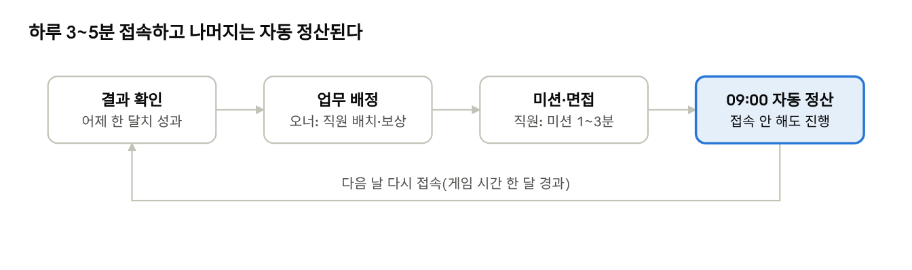
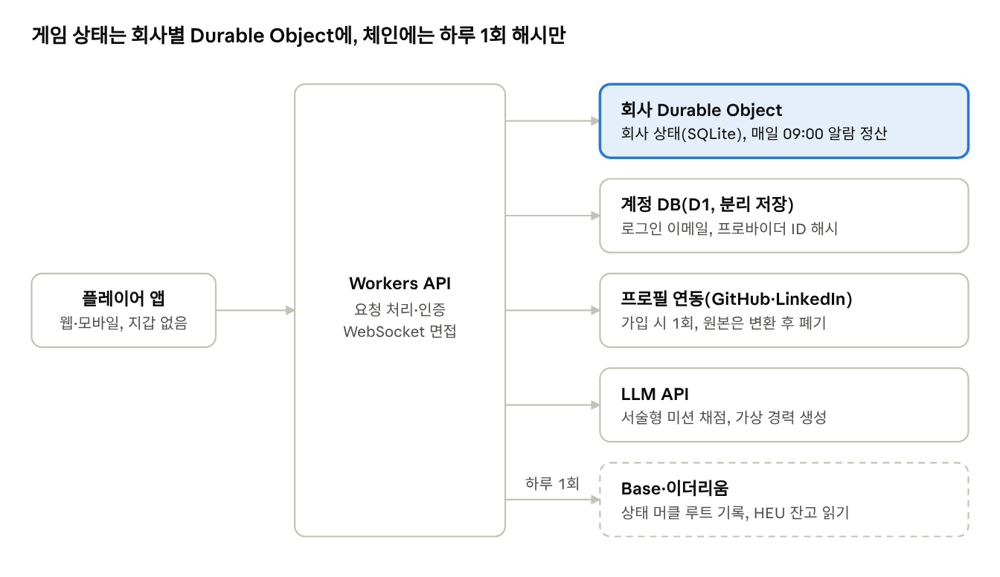

# 스타트업 경영 소셜게임 설계서 v0.1

2026-11-21 · 원본: [Claude Doc](https://claude.ai/artifact/B1Am13sYDVAmGRMSkEcLzm) (이 파일은 내보낸 사본)

## 요약

가상 아바타로 스타트업을 세우고, 직원에게 업무를 맡기고, 투자를 받는 자동 진행형 소셜게임이다. 실제 날짜 하루가 게임 속 한 달이며, 오너는 하루 한 번 명령을 내리고 결과는 정해진 시각에 자동 정산된다.

핵심 결정은 세 가지다.

- **게임 상태는 서버리스(Cloudflare Workers + Durable Objects)에 두고, 블록체인은 하루 1회 상태 해시를 기록하는 용도로만 쓴다.** 같은 규모(월 활성 1만 명)에서 게임 상태를 전부 체인에 쓰면 월 약 6,000\~8,000달러, 서버리스는 월 수십 달러 수준으로 추정된다. 블록체인은 이 게임에서 운영비를 줄이지 못한다. 근거는 백엔드 섹션에 있다.
- **지갑은 heurist 특별룰에만 쓴다.** 이미 지갑이 있는 사람이 서명 한 번으로 주소를 증명하면, 서버가 HEU 보유량을 읽기만 한다. 임베디드 지갑이나 가스비 대납은 필요 없다.
- **실제 프로필은 등급으로만 변환하고 원본은 즉시 폐기한다.** 아바타 이름, 얼굴, 이력은 전부 새로 생성한다.

구현 전에 확인받고 싶은 것은 맨 아래 '구현 전 확인' 섹션에 모았다. 가장 큰 질문은 블록체인 사용 범위다.

## 핵심 루프와 역할

플레이어는 언제나 세 역할 중 하나다. 역할은 시즌 중에도 바뀐다(퇴사하면 무소속, 창업하면 오너).

| 역할 | 하루 접속 시 하는 일 | 접속하지 않으면 | 목표 |
| --- | --- | --- | --- |
| 오너(CEO) | 직원에게 업무 배정, 예산·보상 결정, 면접, 투자 피칭 | 지난 배정을 그대로 반복(자동 위임) | 회사 가치·투자 라운드·엑시트 |
| 직원 | 미션 수행(성과 가산), 만족도 관리, 이직·협상 | 배정된 업무를 기본 능력치로 수행 | 성장(스탯·스톡옵션), 창업 자금 모으기 |
| 무소속 | 구직·면접, 프리랜스 미션, 창업 준비 | 구직 중 표시만 유지 | 취업 또는 창업 |

**코에이 삼국지 시리즈에서 가져오는 것은 메커닉뿐이다.** 이름, 인물, 아트, 용어, UI는 가져오지 않는다.

| 참고 메커닉 | 이 게임에서의 형태 |
| --- | --- |
| 월 단위 턴, 명령 후 일괄 정산 | 실제 하루 = 게임 1개월, 매일 정해진 시각에 정산 |
| 장수 5대 능력치 + 특기 | 직무 능력치 6개 + 특성(피칭, 채용 눈썰미 등) |
| 내정 명령(개발·상업·치안)에 인물 배치 | 업무(개발·영업·마케팅·채용·재무)에 직원 배치 |
| 충성도와 등용·포상 | 만족도와 연봉·스톡옵션·칭찬 |
| 재야 인재 탐색·등용 | 무소속 플레이어 면접·채용 |
| 위임(군단·도시 위임) | 부서장·HR 위임, 면접 위임 |
| 정보의 불확실성(타국 장수 능력 추정) | 면접 전에는 능력치가 오차 범위로만 보임 |

하루 루프는 "접속 → 어제 결과 확인 → 명령·미션 → 오프라인 → 정산" 순서다. 한 번 접속에 3\~5분이면 충분하고, 접속하지 않아도 회사는 돌아간다. 아래 그림이 그 순환이다.



## 시간과 자동 진행 모델

실제 1일이 게임 1개월이고, 한 시즌은 실제 8주(게임 약 4.7년, 시드에서 시리즈 B까지)다. 매일 한국 시각 09:00에 모든 회사가 한 달치를 정산한다.

- **명령 마감**: 정산 직전까지 낸 명령만 반영한다. 새 명령이 없으면 지난달 배정을 그대로 반복한다.
- **지연 계산(lazy evaluation)**: 정산은 회사마다 하루 한 번 알람으로만 돌고, 중간 진행률은 접속 시 "마지막 상태 + 경과 시간"으로 화면에서 계산한다. 매분 틱을 돌리지 않는 것이 운영비 절감의 핵심이다.
- **결정적 난수**: 정산 난수는 (시즌 시드, 회사 ID, 게임월)의 해시로 만든다. 같은 입력이면 누가 다시 계산해도 같은 결과가 나오므로, 나중에 온체인 상태 해시와 대조할 수 있다.
- **오프라인 보호**: 3일 미접속 오너는 회사가 '자동 경영'으로 전환되고, 14일 미접속이면 공동창업자나 최고참 직원에게 대표 권한을 넘길지 투표한다.

업무 1건의 월 성과는 아래 식으로 정한다. 능력치는 0\~100이고 50이 평균이다.

```latex
\text{성과} = B_{\text{업무}} \times \frac{0.7 S_{\text{주}} + 0.3 S_{\text{보조}}}{50} \times \left(0.7 + 0.6\frac{\text{만족도}}{100}\right) \times (1 + 0.2 M) \times \varepsilon,\quad \varepsilon \sim U(0.85, 1.15)
```

S는 업무가 요구하는 주·보조 능력치, M은 그달 미션 수행 여부(0 또는 1)다. 만족도는 성과를 0.7\~1.3배로 바꾼다.

수치 균형을 검증하려고 한 시즌(56개월)을 2,000회 모의 실행했다. 기준은 능력치 50, 만족도 70, 미션 없음인 직원이다.

| 조건 | 시즌 누적 성과(기준 대비) |
| --- | --- |
| 능력치 70인 실력자 | 1.28배 |
| 미션 매일 수행 | 1.20배 |
| HEU 최대 가산(AI·지식 +12, AI 업무에만) | 1.17배 |
| 미션 이틀에 한 번 | 1.10배 |
| 과로로 만족도 월 -2씩 하락 | 0.74배 |

해석: 실력 차이가 가장 크고, 매일 참여는 그다음이며, 토큰 보유는 특정 업무에만 효과가 있어 돈으로 승부가 갈리지 않는다. 직원을 혹사시키는 오너는 분명하게 손해를 본다.

## 시스템 상세

### 회사

회사는 현금, 제품 완성도, 사용자 수, 월 매출(MRR), 브랜드, 조직 분위기 6개 지표를 갖는다. 창업 시 산업(핀테크, AI, 커머스 등)을 고르고, 산업마다 업무 가중치가 다르다. 현금이 0 이하로 2개월 가면 파산이다.

| 업무 | 주 능력치 | 보조 능력치 | 오르는 지표 |
| --- | --- | --- | --- |
| 제품 개발 | 개발 | 기획 | 제품 완성도 |
| AI 기능 개발 | AI·지식 | 개발 | 완성도, 투자 매력도 |
| 기획·디자인 | 기획 | 영업 | 사용자 유지율 |
| 영업·제휴 | 영업 | 리더십 | 매출 |
| 마케팅 | 영업 | 기획 | 사용자 수, 브랜드 |
| 채용·조직관리 | 리더십 | 재무·운영 | 분위기, 면접 정확도 |
| 재무·투자 준비 | 재무·운영 | 리더십 | 현금 소모 감소, IR 점수 |

### 직원과 만족도

만족도(0\~100)는 연봉 수준, 업무 적합도, 업무량, 회사 분위기, 칭찬·승진에서 매달 변한다. 30 이하가 되면 이직 후보가 되고 다른 회사가 제안을 보낼 수 있다. 직원은 월 1회 오너에게 '요청'(연봉 인상, 업무 변경, 휴가)을 보낼 수 있다. 직원도 플레이어이므로 만족도는 숙자이자 협상 수단이다. NPC 직원은 사람이 부족한 초반 시즌을 메우고, 능력치 상한을 플레이어보다 낮게 둔다.

### 미션(직원의 직접 개입)

배정된 업무마다 하루 1개의 짧은 미션이 열린다(1\~3분). 하면 그달 성과가 20% 오르고, 안 해도 기본 성과는 나온다.

- 개발: 짧은 코드 퍼즐, 버그 찾기 선택지
- 기획·마케팅: 두 안 중 더 나은 카피 고르기, 100자 기획 요약
- 영업: 가상 고객 대화 선택지
- AI·지식: 개념 퀴즈

채점은 가능하면 정답형(비용 0)으로 하고, 서술형만 소형 LLM으로 채점한다. LLM 채점은 이 게임의 실제 최대 변동비다(백엔드 섹션 참고).

### 면접(무소속 → 직원)

후보의 진짜 능력치는 숨겨져 있고, 리스트에는 넓은 추정 범위(예: 개발 40\~75)만 보인다. 면접은 이 범위를 좁히는 행위다.

- **실시간 면접**: 오너와 후보가 동시에 접속해 10분 안에 질문 카드 3장을 주고받는다. 범위가 가장 많이 좁아지고(예: ±3), 후보도 회사의 지표 일부를 본다. 양쪽 모두 사람과의 대화가 재미의 핵심이다.
- **위임 면접**: HR 담당 직원(또는 오너 본인의 자동 대리)이 비동기로 진행한다. 오차는 담당자 리더십에 반비례한다(리더십 80이면 ±5, 40이면 ±15). 후보는 서면 질문에 24시간 안에 답한다.
- 결과는 제안서(연봉, 스톡옵션 %, 직책)로 끝나고, 후보는 여러 제안을 비교해 고른다.

### 투자 유치

라운드는 엔젤, 시드, 시리즈 A, 시리즈 B다. 라운드마다 지표 문턱(예: 시리즈 A는 MRR과 성장률)이 있고, 넘으면 NPC VC들이 제안을 낸다. 피칭은 IR 자료 점수(재무 업무 성과)와 오너의 피칭 미션 결과로 밸류에이션을 조정한다. 투자를 받으면 지분이 희석되고, 스톡옵션을 가진 직원 플레이어의 가치도 함께 오른다. 다음 단계에서는 엑시트한 플레이어가 엔젤 투자자로 참여하는 역할을 추가할 수 있다.

시즌 점수는 회사 가치 지분 + 현금이고, 시즌이 끝나면 회사는 초기화되며 아바타의 경력과 칭호만 남는다.

## 아바타와 능력치, 익명화

실제 프로필은 능력치 '등급'으로만 바뀌고, 변환이 끝나면 원본은 저장하지 않는다. 아바타의 이름, 얼굴, 경력 이야기는 모두 새로 만들어 실제 사람을 역추적할 수 없게 한다.

### 능력치 6개

리더십, 개발, 기획, 영업, 재무·운영, AI·지식. 모두 0\~100이고 새 아바타는 총합 한도(예: 270) 안에서 배분된다. 인증은 총합을 올리는 게 아니라 **어느 쪽에 강한지(모양)를 정하는 것**이고, 인증하지 않은 사람도 직접 배분해 동등하게 플레이한다. 그래야 실제 경력이 게임 내 우열로 이어지지 않는다.

### 프로필별로 실제 얻을 수 있는 것

| 출처 | 공식 연동으로 얻는 정보 | 능력치에 쓰는 방식 |
| --- | --- | --- |
| GitHub OAuth(공개 정보 범위) | 공개 저장소의 언어 분포, 활동 기간, 조직 멤버십, 팔로워 수 | 개발·AI·리더십의 비중을 정함 |
| [LinkedIn OIDC 로그인](https://learn.microsoft.com/en-us/linkedin/consumer/integrations/self-serve/sign-in-with-linkedin-v2) | 이름, 사진, 이메일뿐이다. 경력·직무·스킬은 일반 앱에 열려 있지 않다 | 계정이 있다는 사실만 증명 |
| LinkedIn 프로필 PDF(사용자가 직접 업로드) | 직무, 경력 기간, 스킬 | 기획·영업·재무·리더십의 비중을 정함 |

LinkedIn은 공식 문서에서 이 로그인이 본인 확인이 아니라고 밝힌다. 따라서 게임 내 표현은 '본인인증'이 아니라 '경력 연동'으로 한다. PDF 업로드는 조작이 가능하지만, 능력치 총합이 고정이라 조작해도 얻는 게 없다.

### 변환 절차(서버 메모리 안에서만)

1. 연동 데이터를 받아 직무군·기간·언어 같은 **거친 특징 10여 개**로만 줄인다(예: "백엔드 5\~10년", "오픈소스 메인테이너 경험 있음"). 회사명, 학교명, 저장소명, 정확한 숫자는 버린다.
2. 특징을 능력치 비중으로 바꾼 뒤 ±5 난수를 더하고 5단위로 반올림한다.
3. 거친 특징만 LLM에 넘겨 가상의 이름·경력 이야기·특성을 만든다. 실제 회사나 지명이 나오면 다시 생성한다.
4. 저장하는 것은 능력치, 가상 이야기, 그리고 중복 가입을 막기 위한 프로바이더 ID의 비밀키 해시(HMAC)뿐이다. 원본 응답과 OAuth 토큰은 변환 직후 폐기한다.
5. 같은 능력치 조합이 혼자인 경우를 막기 위해 반올림 단위를 키운다(최소 10명이 같은 등급대를 공유하도록 매주 점검).

이 방식이면 운영자조차 아바타의 실제 주인을 능력치로 역추적할 수 없다. 남는 위험은 이메일 로그인 정보 하나뿐이고, 이는 게임 데이터와 다른 저장소에 분리해 둔다.

## heurist 토큰 특별룰

HEU를 1,000개 이상 보유하면 AI·지식 능력치에 +3\~+12를 더한다. 게임이 지갑을 쓰는 곳은 여기뿐이고, 서버는 읽기만 하며 사용자의 토큰을 움직이거나 가스를 쓰게 하지 않는다.

### 연동 절차

1. 사용자가 '특별룰 연동'을 누르면 기존 지갑(메타마스크, 코인베이스 지갑 등)으로 [EIP-4361(Sign-In with Ethereum)](https://eips.ethereum.org/EIPS/eip-4361) 메시지에 서명한다. 트랜잭션이 아니라 가스비가 없다.
2. 서버는 nonce·도메인·만료시각을 확인하고 viem으로 서명을 검증한다. 스마트 계정 지갑(ERC-1271, 배포 전 ERC-6492)도 같은 함수가 처리한다.
3. 검증된 주소를 아바타 하나에 1:1로 묶는다. 주소는 서버 비밀키로 암호화해 저장하고, 다른 플레이어에게는 보여주지 않는다(주소는 공개 장부에서 추적 가능한 식별자이므로).
4. 매일 정산 때 서버가 HEU 컨트랙트의 `balanceOf`를 읽는다. Base의 [HEU(0xEF22…818b)](https://dexrabbit.bitquery.io/base/token/0xef22cb48b8483df6152e1423b19df5553bbd818b)와 이더리움 메인넷 [HEU(0xEC46…a6ea)](https://etherscan.io/token/0xec463D00aa4dA76fb112cD2e4AC1C6BeF02da6ea)를 합산한다. 구현 전에 heurist 공식 문서로 두 주소를 다시 확인해야 한다.

### 가산점 곡선

| 보유량(HEU) | AI·지식 가산 | 대략적 매입 비용 |
| --- | --- | --- |
| 1,000 미만 | 0 | - |
| 1,000 | +3 | 약 1.5달러 |
| 10,000 | +6 | 약 15달러 |
| 100,000 | +9 | 약 150달러 |
| 1,000,000 이상 | +12(상한) | 약 1,500달러 |

가산 = min(12, 3 + 3×log10(보유량/1000)). 매입 비용은 [CoinGecko](https://www.coingecko.com/en/coins/heurist)의 시총·유통량으로 계산한 약 0.0015달러/HEU 기준이고 가격에 따라 크게 변한다. 로그 곡선이라 소량 보유자도 체감되고, 고래가 게임을 지배하지 못한다. 시뮬레이션상 상한(+12)은 AI 업무 성과를 약 17% 올리고, 이는 능력치 70 실력자의 +28%보다 작다.

### 악용 방지

- **돌려쓰기**: 한 주소는 한 시즌에 한 아바타에만 묶인다. 토큰을 다른 지갑으로 옮겨 두 번째 아바타에 쓰는 것을 막기 위해, 가산은 **최근 7일 일일 잔고 중 최솟값** 기준이다.
- **순간 차입**: 매일 스냅샷을 보므로 하루 빌려서는 가산을 못 받는다.
- **가격 리스크**: 유동성이 작은 토큰이라 상한을 사는 비용이 낮다. 그래서 가산은 AI·지식 한 능력치에만 주고 상한을 둔다.
- **법적 검토**: 게임은 토큰을 팔거나 지급하지 않고 보유 여부만 읽는다. 그래도 특정 토큰 보유를 유도하는 것으로 보일 수 있어 출시 전 검토가 필요하다. heurist 측과 협업 관계인지도 정해야 한다.

조회 비용은 연동한 사용자 수 × 2개 체인 × 하루 1회다. 1만 명이면 하루 2만 번의 읽기이고, multicall로 묶으면 수백 번이라 무료 RPC 한도 안에 들어간다.

## 백엔드 아키텍처와 비용

**정직한 결론: 이 게임에서 블록체인은 운영비를 줄이지 않는다.** 플레이어 행동을 체인에 쓰면 행동 하나마다 수수료가 나가고, 사용자가 지갑을 모르게 하려면 그 수수료를 운영자가 대납해야 한다. 반면 서버리스는 요청이 없을 때 비용이 0이고 무료 포함량이 커서, 이 게임 규모에서는 두 자릿수 이상 싸다.

가정: 월 활성 1만 명, 일 활성 3천 명, 1인 하루 쓰기 행동 30회(월 270만 건), 회사 1천 개.

| 안 | 구조 | 월 운영비 추정(달러) | 사용자의 블록체인 노출 | 비고 |
| --- | --- | --- | --- | --- |
| C. 서버리스 + 온체인 기록(결정, 2026-11-21) | B에 더해 하루 1회 전체 상태의 머클 루트를 Base에 기록 | 약 5\~10 + LLM 90\~540 | 없음(heurist 연동만 선택) | 정산 결과를 운영자가 몰래 바꾸지 않았음을 누구나 검증 |
| B. 서버리스만 | Cloudflare Workers + 회사당 Durable Object(SQLite) + 알람 | 약 5 + LLM 90\~540 | 없음 | 가장 싸고 단순 |
| A. 게임 상태 전부 온체인(Base) | 행동마다 트랜잭션, 임베디드 지갑 + 가스 대납 | 약 5,700 + 인덱서·RPC + LLM | 숨겨도 지갑 생성·서명이 뒤에서 일어남 | 규모가 10배면 가스만 월 약 5만 달러 |
| D. 전용 앱체인(OP Stack/Orbit) | 가스를 0에 가깝게 둔 자체 L2 | 미확인(RaaS 견적 필요) | A와 같음 | 시퀀서·브리지·인덱서 운영 부담이 새로 생김 |



권장안 C에서 플레이어 앱은 Workers만 부르고, 체인은 서버가 하루 한 번 기록하거나 잔고를 읽을 때만 닿는다.

계산 근거:

- A의 가스는 270만 건 × 0.0019달러다. 0.0019달러는 [growthepie](https://www.growthepie.com/answers/are-ethereum-l2-fees-getting-cheaper)의 2026년 10월 L2 수수료 중앙값(0.19센트)이다. 회사 정산 3만 건(약 57달러)과 [Privy](https://www.privy.io/pricing) 임베디드 지갑 Scale 요금(월 499달러, MAU 2,500\~9,999)을 더했다. Base는 최소 기본료가 있고 L1 비용이 별도라([Base 문서](https://docs.base.org/chain/fees)) 가스 효율을 아무리 올려도 건당 비용이 0이 되지 않는다.
- B는 [Workers](https://developers.cloudflare.com/workers/platform/pricing/) 유료 플랜 최소 5달러에 요청 1천만 건이 포함되고, [Durable Objects](https://developers.cloudflare.com/durable-objects/platform/pricing)는 요청 100만 건·행 쓰기 5천만 건·처리시간 40만 GB-s가 포함된다. 270만 행동 기준 초과분은 DO 요청 약 0.26달러뿐이다. 실시간 면접은 하이버네이션되는 WebSocket을 쓰면 처리시간이 거의 늘지 않는다.
- LLM은 서술형 미션 채점(일 활성 1인당 하루 1\~2건, 건당 0.001\~0.003달러 가정)이다. 어느 안을 고르든 같고, 실제 최대 비용이다. 정답형 미션 비중을 높이면 줄일 수 있다.
- C의 온체인 기록은 하루 1건이라 월 1달러 미만이다. 운영자 지갑 하나가 내므로 사용자는 지갑이 필요 없다.

### 그래도 블록체인을 쓸 이유

비용이 아니라 **신뢰**다. 시즌 시드를 미리 체인에 공개하고 매일 상태 루트를 기록하면, 플레이어는 자기 회사의 정산이 공정했는지 스스로 확인할 수 있다. 운영이 중단돼도 시즌 기록(우승 회사, 칭호)은 남는다. 나중에 활성 유저가 많아지면 토큰·정보를 실제 자산으로 옮기는 경로도 열어 둔다. 이 경우에도 사용자가 가스를 직접 내지 않는 한 운영비는 오른다.

## 운동 서비스 연동 보너스

Garmin·Strava를 연동하면 '체력'이 오른다. 체력은 7번째 능력치가 아니라 과로에 버티는 힘이다. 업무 성과를 직접 올리지 않고, 업무량이 많을 때 만족도가 덜 떨어지게 하며, 아래 '개인 역량 개선'의 훈련 효율을 올린다. 운동을 많이 한 사람이 아니라 **꾸준히 한 사람**에게 주는 보상이다.

### 실제 연동 조건

| 서비스 | 접근 조건 | 이 게임에 미치는 영향 |
| --- | --- | --- |
| [Strava API](https://developers.strava.com/docs/getting-started/) | 앱 개설에 Strava 구독 필요. 새 앱은 본인 1명만, 업그레이드 시 10명, 그 이상은 심사 통과 후. 기본 한도는 15분에 200회, 하루 2,000회([한도](https://developers.strava.com/docs/rate-limits/)) | 출시 전에 Strava 심사를 받아야 한다. 웹훅으로 새 활동만 받아 호출 수를 줄인다 |
| [Strava API 약관](https://www.strava.com/legal/api)(2026-06-01 시행) | 사용자의 데이터는 그 사용자 본인에게만 보여줄 수 있고, 해지 시 전부 삭제해야 함. 연동 해제를 웹훅으로 받아야 함 | 다른 플레이어에게는 체력 등급의 출처나 운동 기록을 보여주지 않는다. 파생 값(등급)을 남에게 보여도 되는지는 법률 검토 항목 |
| [Garmin Connect 개발자 프로그램](https://developer.garmin.com/gc-developer-program/overview/) | 비즈니스 Starter 등급을 신청서로 신청. 활동·건강 API 포함, 푸시 방식만, 과거 데이터 없음, 사용자 수 제한 | 연동 시점부터 쌓인 기록만 쓴다. 규모가 커지면 Enterprise 협의가 필요 |

두 서비스 모두 운영자가 심사를 받아야 문이 열리므로, 출시 일정에서 몇 주를 잡아야 한다. 모바일 앱을 만들면 나중에 Apple 건강·Google Health Connect로 기기 안에서 읽는 방식도 추가할 수 있다.

### 보너스 기준

- 입력은 '최근 4주 동안 운동한 주의 수'와 '주당 운동한 날'만 쓴다. 거리, 속도, 심박, 체중, 위치는 읽더라도 저장하지 않는다.
- 주 3일 이상을 만점으로 보고, 강도는 따지지 않는다. 마라톤 선수와 주 3회 걷는 사람이 같은 등급이다. 부상이나 장애가 있는 사람을 불리하게 만들지 않기 위해서다.
- 체력은 4단계(0\~3)이다. 최고 단계에서는 과로로 인한 만족도 하락이 절반이 되고, 개인 훈련 효율이 10% 오른다.
- 기기가 없는 사람도 게임 안의 '휴식·운동' 스케줄로 체력을 1\~2단계까지 올릴 수 있다. 연동은 최고 단계까지 가는 지름길이다.
- 매주 수치를 다시 계산하고 이전 주 값은 덮어쓴다. 연동 해제 시 체력은 게임 내 수준으로 돌아가고 토큰은 즉시 폐기한다.

### 밸런스

과로 상태(만족도 월 -2)에서 시즌 성과는 기준 대비 0.74배였다. 체력 최고 단계면 하락이 월 -1이 되어 0.85배다. 즉 운동 보너스는 '더 잘하게' 만들기보다 '덜 무너지게' 만든다. HEU는 AI·지식 업무의 성과를, 운동은 버티는 힘을 올리므로 두 가산은 서로 겹치지 않고 한 능력치 +15 상한에도 영향을 주지 않는다.

### 건강 데이터 취급

운동 기록은 민감정보에 가깝다. 그래서 서버는 웹훅을 받은 요청 안에서 '이번 주 운동한 날 수'만 계산해 저장하고 원본은 버린다. 연동 동의 화면에 "어떤 값을 읽고 무엇을 남기는지"를 분명히 적고, 운동 토큰은 게임 DB가 아닌 계정 DB에 암호화해 둔다.

## 개인 역량 개선

모든 플레이어는 매달 개인 스케줄 3칸을 짜서 능력치를 키운다. 육성 시뮬레이션의 '스케줄 배정 → 성장, 피로 관리' 구조에 학습 과학(간격 반복, 주 단위 습관, 멘토링)을 더해, 게임 속 성장이 실제 학습과 이어지게 했다. 프린세스 메이커에서는 메커닉만 가져오고, 인물·설정·아트·엔딩 체계는 가져오지 않는다.

### 스케줄과 피로

| 칸에 넣는 활동 | 효과 | 비용 |
| --- | --- | --- |
| 수업(능력치 1개 선택) | 그 능력치 성장 | 피로 +15, 수강료(게임 내 화폐) |
| 휴식·운동 | 피로 -25, 체력 단계 유지 | 없음 |
| 부업 | 개인 현금(창업 자금) | 피로 +10 |
| 네트워킹 | 면접 제안·투자자 소개 확률 | 피로 +5 |

피로가 60을 넘으면 수업 효율이 절반이 되고, 80을 넘으면 다음 달 한 칸이 강제 휴식이 된다. 수업 2칸과 휴식 1칸이 오래 유지되는 기본 리듬이다. 스케줄은 한 번 짜 두면 매달 반복되므로 접속하지 않아도 성장한다.

### 성장식

```latex
\Delta S = 0.4 \times \left(1 - \frac{S}{120}\right) \times \text{효율},\quad \text{효율} = \text{피로 보정} \times (1 + \text{복습 보너스} + \text{멘토 보너스} + \text{체력 보너스})
```

능력치가 높을수록 성장이 느려지므로 약한 사람이 더 빨리 따라온다. 한 능력치에 매달 수업 2칸을 한 시즌 내내 넣으면(보너스 없이) 30은 약 58, 50은 약 72, 70은 약 86이 된다. 시작 능력치 차이 40이 한 시즌 뒤 약 28로 줄어든다. 상한은 95이고, 능력치는 시즌이 바뀌어도 경력으로 남는다.

### 실제 역량으로 이어지는 장치

- **5분 학습 카드**: 수업을 넣은 능력치에 대해 매일 실제 학습 카드가 나온다(개발은 코드 읽기, 재무는 지표 계산, AI·지식은 개념 문제). 틀린 카드는 1·3·7일 뒤에 다시 나온다(간격 반복). 그달 카드의 70% 이상을 맞히면 복습 보너스 +20%다.
- **주 단위 습관**: 매일 연속 기록 대신 "이번 주 4일 이상"으로 판정한다. 하루 빠져도 습관이 깨지지 않아, 부담보다 꾸준함을 보상한다.
- **성장 트리와 특성**: 능력치가 60·75·90에 닿으면 두 갈래 특성 중 하나를 고른다(예: 개발 75에서 '설계자'는 팀 개발 성과 +5%, '해결사'는 개발 미션 보상 +30%). 특성은 최대 3개라 아바타마다 성격이 생긴다.
- **멘토링(소셜)**: 같은 회사에서 그 능력치가 15 이상 높은 동료에게 멘토를 요청한다. 멘티는 효율 +25%, 멘토는 리더십 성장과 평판을 얻는다. 오너는 멘토링을 회사 제도로 장려할 수 있다.
- **주간 성장 리포트**: 능력치 변화, 맞힌 카드 수, 실제 학습 시간을 매주 보여준다. 게임 밖에서도 자기 발전을 확인하는 장이다.

아이템(장비)은 착용 한도 안에서 능력치에 더해지는 것이고, 성장은 능력치 자체를 올리므로 돈으로 성장을 살 수는 없다. 학습 카드는 정답형 위주라 LLM 비용이 거의 없다.

## 코인 결제 아이템과 착용 한도

아이템은 USDC(Base)로 살 수 있고, 지갑은 결제하는 그 순간에만 쓴다. 게임 계정에 지갑을 연결해 두지 않는다. 능력치에 주는 아이템 효과는 아바타별 착용 한도로 묶어, 돈을 써도 실력 차이를 넘지 못하게 한다.

### 결제 방식

| 방식 | 수수료 | 사용자 경험 | 운영 부담 |
| --- | --- | --- | --- |
| [Coinbase Commerce](https://docs.cdp.coinbase.com/commerce/accepting-payment/faq)(권장) | 1% | 결제 페이지에서 코인베이스 계정이나 아무 지갑으로 송금. Ethereum·Polygon·Base 지원 | 웹훅 하나만 받으면 됨 |
| 직접 송금 검증 | 0%(구매자 가스 약 0.002달러) | 주문별 주소·금액으로 송금 | 입금 감시, 환불, 회계 처리를 직접 해야 함 |
| [Stripe 스테이블코인](https://docs.stripe.com/crypto/stablecoin-payments.md) | 약 1.5%([보도](https://finance.yahoo.com/news/stripe-charges-1-5-stablecoin-145737023.html)) | 카드와 같은 결제창 안에서 선택 | 미국·EU 등 일부 국가 사업자만 가능. 한국 법인은 현재 목록에 없음 |

구매 흐름: 상점에서 아이템 선택 → 결제 페이지로 이동 → 송금 → 웹훅이 확정(`charge:confirmed`)되면 서버가 아바타 인벤토리에 지급. 아이템은 서버 DB에만 있고 NFT로 발행하지 않으며 거래도 막는다. 거래를 막아야 환전 문제를 피하고 운영비도 늘지 않는다. 같은 아이템을 카드로도 살 수 있게 해 코인을 모르는 사용자도 배제하지 않는다.

### 아이템 종류

| 종류 | 예 | 효과 | 시즌 종료 시 | 구매 방법 |
| --- | --- | --- | --- | --- |
| 꼴미기 | 아바타 의상, 사무실 인테리어, 회사 로고 테마 | 없음 | 유지 | 코인·카드 |
| 장비 | 고성능 노트북(개발), 명함 케이스(영업), 어학 강좌(기획) | 능력치 +1\~+5, 착용 한도 안에서만 | 소멸 | 코인·카드·게임 내 화폐 |
| 편의 | 면접 다시 잡기, 알림 슬롯 추가 | 시간 절약 | 소멸 | 코인·카드·게임 내 화폐 |

랜덤박스(확률형 아이템)는 두지 않는다. 한국은 확률 공개 의무가 있고, 코인과 결합하면 규제 위험이 커진다. 장비는 게임 내 화폐로도 단계적으로 얻을 수 있게 해 코인은 시간을 아끼는 수단으로 둔다.

### 개인별 착용 한도

한도는 아바타마다 다르고, 돈이 아니라 플레이로만 늘어난다.

- **착용 슬롯 4칸**: 능력치 하나당 장비 1개.
- **착용 포인트**: 장비 가산의 합계는 '착용 포인트'를 넘지 못한다. 착용 포인트 = 4 + 경력 개월수/6(시즌 내 최대 +10). 새 아바타는 비싼 장비를 사도 가산이 4까지만 들어간다.
- **능력치별 상한**: 한 능력치에 붙는 외부 가산(장비 + HEU)은 합쳐서 +15를 넘지 못한다.
- **자가 결제 한도**: 사용자가 월 결제 한도를 직접 정할 수 있게 하고, 기본값은 월 50달러다. 올리는 것은 7일 뒤에 적용한다.

성과식에 넣어 보면, 착용 한도를 다 채운 장비(+10)는 그 업무 성과를 1.14배로, 장비와 HEU를 합친 상한(+15)은 1.21배로 올린다. 실력자(능력치 70)의 1.28배보다 낮아서 결제만으로는 실력자를 넘지 못한다.

### 주의할 점

- **iOS 앱 안에서는 코인 결제와 HEU 특별룰을 열 수 없다.** 애플 심사 지침은 암호화폐나 지갑으로 기능을 여는 것을 막는다([AppleInsider, 2022-10](https://appleinsider.com/articles/22/10/24/apple-has-new-app-store-rules-for-nfts-and-cryptocurrency)). 그래서 첫 출시는 웹(PWA)으로 하고, 네이티브 앱에서는 두 기능을 끄는 것을 전제로 한다.
- 한국에서 가상자산으로 게임 아이템을 파는 것은 출시 전 법률 검토가 필요하다. 게임물 등급 분류와 환전 금지 규정이 포함된다.
- 운영비 영향은 거의 없다. 매출의 1%가 수수료이고, 서버는 웹훅 처리만 더하면 된다.

## 대안: 삼국지 세계관 매핑

엔진(세력·인물·업무·충성·일일 정산)은 그대로 두고 테마만 삼국지로 바꾸는 것은 가능하고, 백엔드 비용도 달라지지 않는다. 다만 실제 프로필을 능력치로 있는 핵심 장치와 어울림이 약해져서, **스타트업 테마에 삼국지의 구조만 입힌 '테크 삼국지'로 결정했다(2026-11-21)**이고, 순수 삼국지는 나중에 테마 시즌으로 시험해 볼 수 있다.

### 매핑표

| 현재 설계 | 삼국지 매핑 | 테크 삼국지(권장) |
| --- | --- | --- |
| 회사 | 세력(군웅) | 스타트업, 세 가상 거대 플랫폼 진영 중 하나와 제휴 |
| 오너 | 군주 | CEO |
| 직원 | 장수·책사 | 직원 |
| 무소속 | 재야 인재 | 구직자 |
| 실시간 면접 | 등용 방문(삼고초려처럼 거절·재방문) | 면접, 인재 빼오기 제안 |
| 위임 면접 | 천거(추천) | HR 위임 |
| 업무 | 내정(개간·상업·치수·징병·외교) | 개발·영업·마케팅·채용·재무 |
| 만족도 | 충성도 | 만족도 |
| 미션 | 계책·군리 퀴즈, 단기전 미니게임 | 코드·기획·영업 미션 |
| 투자 유치 | 호족·상인 후원, 동맹 | VC 라운드, 진영 전략적 투자 |
| 라운드 성장 | 관직·작위 승급 | 시드 → 시리즈 B |
| 경쟁 | 전쟁·영토 점령 | 시장 점유율 다툼, M&A(흡수) |
| 시즌 종료 | 천하통일·할거 | 엑시트·IPO |
| HEU 가산 | 책사의 지력·병법 | AI·지식 |

### 장단점

| 기준 | 삼국지 매핑 | 스타트업(테크 삼국지) |
| --- | --- | --- |
| 처음 이해하기 | 매우 쉽다. 동아시아 이용자가 이미 아는 판타지 | 설명이 조금 필요 |
| 프로필 기반 능력치 | 어색하다. GitHub 활동이 왜 '무력'이 되는지 설득력이 약함 | 자연스럽다. 내 실제 역량이 그대로 반영됨 |
| 타깃 이용자 | 역사·전략게임 팬 | 개발자·기획자·창업 관심층(LinkedIn·GitHub 사용자와 일치) |
| 소셜 갈등 | 전쟁·배신·동맹으로 강하다 | M&A·인재 빼오기로 비슷하게 만들 수 있음 |
| 설계 복잡도 | 전투를 넣으면 밸런스·자동화가 크게 어려워짐 | 현재 설계 그대로 |
| 시장·법적 위험 | 코에이 시리즈와 정면 비교, 클론 인식 | 낮음 |
| 아바타 | 플레이어는 가상 장수이고, 조조·유비 같은 역사 인물은 NPC로만 둠 수 있음 | 제약 없음 |

### 삼국지를 쓸 때의 선

역사와 소설 삼국지연의의 인물·사건은 공공 영역이라 쓸 수 있다. 반면 코에이 게임의 고유 요소는 가져오지 않는다. 게임 제목, 초상화·아트, UI 배치, 게임 전용으로 만든 인물, 특정 작품의 능력치 조합과 수치, 음악이 여기에 해당한다. 그래서 능력치는 이 설계서의 6개를 유지하고 이름만 시대에 맞게 바꾼다(예: 리더십 → 통방, AI·지식 → 병법).

### 테크 삼국지 설정(초안)

시장은 가상의 거대 플랫폼 세 진영이 나눌 갖고, 플레이어의 스타트업은 그 사이의 군웅이다. 실존 기업을 본뜨지 않고 성격만 삼국의 구도를 따른다. 진영 이름은 가칭이다.

| 진영(가칭) | 성격 | 강점 | 약점 | 제휴 혜택 |
| --- | --- | --- | --- | --- |
| 북방 인프라 그룹 | 최대 자본의 클라우드·인프라 패권자 | 자본, 안정적 투자 | 관료주의, 인수 후 만족도 하락 | 라운드 성공률 +, 개발 업무 +5% |
| 서방 오픈 연합 | 자본은 적지만 명분과 커뮤니티가 있는 오픈소스 진영 | 인재 끌어들이기, 만족도 | 자금 조달 | 면접 수락률 +, 만족도 하락 완화 |
| 남방 무역·핀테크 연합 | 결제·물류를 쥐고 실리로 동맹을 바꾸는 진영 | 매출, 현금 흐름 | 충성도 낮음(동맹 교체) | 영업·재무 업무 +5% |

- **제휴**: 스타트업은 시즌당 한 진영과 제휴할 수 있다(선택). 제휴하면 진영 혜택과 진영 VC에 접근하고, 그 대신 경쟁 진영의 인수 대상이 된다. 제휴 변경은 게임 6개월에 한 번이다.
- **진영 패권**: 진영 점수는 제휴 스타트업 가치의 합이다. 시즌 중에 진영 순위가 바뀌는 것이 모두가 공유하는 이야기이고, 시즌이 끝나면 우승 진영의 제휴사 전원이 칭호를 받는다.
- **M&A(흡수)**: 회사 가치가 3배 이상인 회사는 인수 제안을 낼 수 있다. 대상 오너가 동의하거나, 대상의 현금이 2개월 이내로 바닥나면 성사된다. 직원은 승계되지만 만족도가 20 떨어지고, 피인수 오너는 사업부장으로 남거나 지분을 현금으로 받아 떠난다.
- **인재 빼오기**: 다른 회사의 직원 플레이어에게 월 1회 제안을 보낼 수 있다. 원래 오너에게 알림이 가고, 오너는 24시간 안에 역제안을 할 수 있다. 결정은 직원 본인이 한다.
- **진영 이벤트**: 게임 월마다 시즌 시드로 정해진 사건(규제 강화, AI 붐, 금리 인상 등)이 한 진영에 유리하거나 불리하게 작용한다. 시드가 시즌 시작 때 온체인에 기록되므로, 운영자가 중간에 이벤트를 조작할 수 없다.
- **용어**: '등용 제안', '군자금(런웨이)', '제휴는 동맹' 같은 표현을 부제목·이벤트 문구에서만 살짝 쓴다. 기본 화면 용어는 스타트업 용어로 두어 프로필 연동 능력치와 어울리게 한다.

진영 이름과 세계관 문구는 아트 방향을 정할 때 함께 확정한다.

### 구현상 결론

도메인 용어(회사/세력, 만족도/충성도)를 텍스트 테마 파일로 분리해 두면, 같은 정산 엔진에서 두 테마를 모두 돌릴 수 있다. 추가 비용은 아트와 문구뿐이다. 단, 전투(영토 점령)를 넣는다면 별도 설계가 필요하다.

## 리스크와 구현 전 확인

| 리스크 | 대응 |
| --- | --- |
| 초반에 사람이 적어 면접·채용이 돌지 않음 | NPC 직원·후보로 채우고 사람이 늘면 비중을 줄임 |
| 오너가 빠지면 직원 플레이어가 피해 | 자동 경영과 14일 후 대표 교체 투표 |
| 프로필 연동에 대한 거부감 | 연동은 선택이고 능력치 총합에 영향 없음을 가입 화면에 명시 |
| HEU 가격 급변으로 밸런스 붕괴 | 보유 개수 기준 로그 곡선과 +12 상한, 시즌마다 문턱 재검토 |
| LLM 비용이 예상보다 큼 | 서술형 미션은 하루 1건 제한, 정답형 우선 |

구현에 들어가기 전에 아래 네 가지를 확인받고 싶다.

- [ ] 백엔드를 C안(서버리스 + 하루 1회 온체인 기록)으로 가도 되는가. 블록체인 비중을 더 키우고 싶다면 그 이유(신뢰, 자산 소유, 투자 유치 스토리 등)를 알려 달라.
- [ ] LinkedIn은 API로 경력을 주지 않는다. 프로필 PDF 업로드 방식을 받아들일지, GitHub만 먼저 할지.
- [ ] 시즌 길이(8주)와 하루 1회 정산(한국 시각 09:00)이 적당한가.
- [ ] heurist 측과 협업을 전제로 하는가, 아니면 독자적인 특별룰인가.

추가 요청으로 생긴 확인 항목이다.

- [ ] 테마: 테크 삼국지로 결정(2026-11-21).
- [ ] 코인 결제: Coinbase Commerce(수수료 1%)로 시작해도 되는지, 첫 출시를 웹으로 하는 데 동의하는지.
- [ ] 운동 연동: Strava 앱 심사와 Garmin 신청을 출시 전에 진행할지, 아니면 2차 기능으로 미룰지.

확인이 끝나면 다음 단계는 정산 엔진(성과식·만족도·투자)을 테스트 가능한 라이브러리로 먼저 만들고, 그다음 Workers 백엔드와 화면을 붙이는 것이다. 저장소도 하나 필요하다.

### 출처

- [growthepie, L2 수수료 추이](https://www.growthepie.com/answers/are-ethereum-l2-fees-getting-cheaper)
- [Base 수수료 문서](https://docs.base.org/chain/fees)
- [Privy 요금](https://www.privy.io/pricing)
- [Cloudflare Workers 요금](https://developers.cloudflare.com/workers/platform/pricing/)
- [Cloudflare Durable Objects 요금](https://developers.cloudflare.com/durable-objects/platform/pricing)
- [Sign In with LinkedIn using OpenID Connect](https://learn.microsoft.com/en-us/linkedin/consumer/integrations/self-serve/sign-in-with-linkedin-v2)
- [EIP-4361 Sign-In with Ethereum](https://eips.ethereum.org/EIPS/eip-4361)
- [CoinGecko, Heurist](https://www.coingecko.com/en/coins/heurist)
